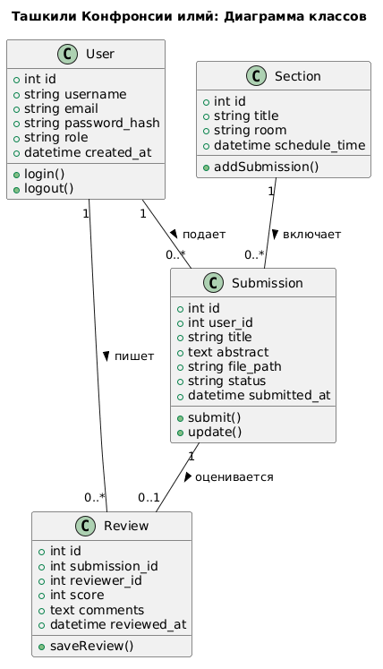
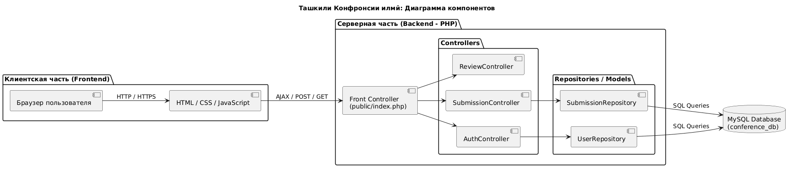

# Супориши техникӣ барои коркарди низоми иттилоотии «Ташкили конфронсии илмӣ»
<<<scientific-conference>>>

Версияи 1.0  
19.11.2026  
Кумитаи тадорукот ва бахши илми донишгоҳ (фармоишгар, шартан)

---

## 1. Маълумоти умумӣ

* **Номи пурраи система:** Низоми иттилоотии автоматикунонидашудаи «Ташкили конфронсии илмӣ».
* **Номи кӯтоҳ:** `scientific-conference`.
* **Фармоишгар:** Кумитаи тадорукоти конфронсҳои илмӣ ва шӯъбаи илми донишгоҳ.
* **Иҷрокунанда (Барномасоз):** Эргашев Парвиз, донишҷӯи курси 3, гурӯҳи `<Рақами гурӯҳи худро нависед>`.
* **Мӯҳлати иҷро:** Семестри тирамоҳии соли таҳсили 2026–2027 (рӯзҳои 1–16-и нақшаи курс)[cite: 12].
* **Асос барои коркард:** Супориши таълимӣ аз фанни «Лоиҳакашии низомҳои иттилоотӣ» ва эҳтиёҷоти автоматикунонии раванди баргузории конфронсҳои илмӣ-амалӣ.

---

## 2. Таъинот ва мақсадҳои эҷоди система

**Таъиноти система:** Автоматикунонии пурраи давраи ҳаётии баргузории конфронси илмӣ — аз эълони конфронс ва бақайдгирии иштирокчиён то қабули мақолаҳо, тақриздиҳии онҳо, тартиб додани барномаи конфронс ва нашри маҷмӯаи мақолаҳо.

**Мақсадҳои ченшавандаи эҷоди система:**
1. **Кам кардани вақти коркард ва тақриздиҳии мақола:** Аз 5–7 рӯзи корӣ (ҳангоми қабули дастӣ ва почта) то **1–2 рӯз**.
2. **Суръат бахшидан ба тартиб додани барномаи конфронс:** Аз 3 рӯзи кори дастӣ дар Excel/Word то **15 дақиқа**.
3. **Ба сифр расонидани талафоти ҳуҷҷатҳо:** Нигоҳдории мутамаркази 100%-и файлҳои мақолаҳо ва таърихи тағйири ҳолати онҳо дар базаи додаҳо.
4. **Дастрасии шабонарӯзӣ (24/7):** Имконияти пешниҳоди мақола ва пайгирии ҳолати он барои муаллифон аз дилхоҳ вақт.

---

## 3. Тавсифи объекти автоматикунонӣ

**Объекти автоматикунонӣ:** Раванди ташкил ва баргузории конфронсҳои илмӣ-амалии донишгоҳӣ.

**Акторҳо (Нақшҳои система):**
1. **`admin` (Администратор):** Идоракунии корбарон, додани ҳуқуқ ва нақшҳо, эҷоди конфронсҳо ва бахшҳои илмӣ, назорати техникии система.
2. **`organizer` (Ташкилкунанда / Котиби масъул):** Дидани ҳамаи мақолаҳои воридшуда, таъини тақризгарон (`reviewer`) ба мақолаҳо, қабули қарори ниҳоӣ (қабул ё рад кардан) дар асоси тақриз ва тартиб додани ҷадвали баромадҳо.
3. **`reviewer` (Тақризгар / Эксперт):** Омӯзиши мақолаҳои ба ӯ вобасташуда, гузоштани баҳо, навиштани тақриз ва додани тавсия («Қабул шавад», «Таҳрир лозим аст», «Рад шавад»).
4. **`author` (Муаллиф / Иштирокчӣ):** Сабти ном дар система, интихоби бахши илмӣ, боркунии файли мақола (`.docx` / `.pdf`) ва пайгирии ҳолати он дар кабинети шахсӣ.

**Равандҳои асосии тиҷоратӣ:**
* *Қаблан:* Муаллиф мақоларо ба почтаи электронии котиб мефиристод, котиб онро дастӣ ба ҷузвдонҳо ҷудо карда, ба эксперт мефиристод; ҷавобҳо гум мешуданд.
* *Акнун:* Ҳамаи амалҳо дар як системаи ягона сурат мегиранд; ҳар мақола рақами мушаххас ва ҳолати дақиқ дорад.

**Луғати истилоҳот:**
* **Мақола:** Матни илмии пешниҳодшуда аз ҷониби муаллиф барои иштирок дар конфронс.
* **Бахш:** Самти мушаххаси илмии конфронс (масалан, «Технологияҳои иттилоотӣ», «Иқтисодиёт»).
* **Тақриз:** Хулосаи хаттӣ ва баҳои эксперт оид ба сифати илмии мақола.

**Хулоса аз таҳлили аналогҳо (EasyChair, OpenConf, Google Forms):**
* *EasyChair* имконоти зиёд дорад, вале интерфейсаш мураккаб, танҳо бо забони англисӣ буда, барои конфронсҳои маҳаллӣ пулакӣ аст.
* *Google Forms* ройгон аст, вале раванди тақриздиҳӣ ва назорати нақшҳоро надорад.
* *Хулоса:* Системаи мо ройгон, сода, бо интерфейси тоҷикӣ буда, ба талаботи донишгоҳ мутобиқ карда шудааст.

---

## 4. Талабот ба система

### 4.1. Талабот ба система дар маҷмӯъ

**Талаботи ғайрифунксионалӣ (ТҒФ):**
* **ТҒФ-01 (Суръати кор):** Вақти кушодашавии саҳифаҳо ва коркарди дархостҳо ба базаи додаҳо набояд аз **1.5 сония** зиёд бошад (ҳангоми то 100 корбари ҳамзамон).
* **ТҒФ-02 (Боэътимодӣ ва нусхаи эҳтиётӣ):** Нусхабардории эҳтиётии автоматии базаи додаҳо ҳар рӯз соати 02:00 анҷом дода мешавад[cite: 11]. Дастрасии система — 99.5%.
* **ТҒФ-03 (Амният):** Рамзҳои корбарон дар базаи додаҳо танҳо дар шакли рамзгузоришуда (хэш бо `password_hash`) нигоҳ дошта мешаванд. Ҳимоя аз SQL-инъексия (PDO Prepared Statements) ва XSS.
* **ТҒФ-04 (Боркунии файлҳо):** Система танҳо файлҳои форматҳои `.pdf` ва `.docx`-ро бо ҳаҷми на зиёда аз **10 МБ** қабул мекунад.
* **ТҒФ-05 (Мутобиқшавӣ):** Интерфейс дар экранҳои компютер (1920x1080) ва телефонҳои мобилӣ (360x800) бе таҳриф намоиш дода мешавад.

---

### 4.2. Талабот ба функсияҳо

**Рӯйхати талаботи функсионалӣ (ТФ) бо авлавияти MoSCoW:**

| Рамз | Номи функсия | Тавсифи мухтасар | MoSCoW |
|---|---|---|---|
| **ТФ-01** | Бақайдгирӣ ва воридшавӣ | Бақайдгирии муаллифони нав ва авторизатсияи ҳамаи 4 нақш | **Must** |
| **ТФ-02** | Идоракунии корбарон | Сохтан, таҳрир ва таъини нақшҳо (`admin`, `organizer`, `reviewer`, `author`) | **Must** |
| **ТФ-03** | Идоракунии бахшҳои конфронс | Эҷод ва таҳрири бахшҳои илмии конфронс ва мӯҳлатҳои қабул | **Must** |
| **ТФ-04** | Пешниҳоди мақола | Пур кардани шакли мақола (ном, аннотатсия, калидвожаҳо) ва боркунии файл | **Must** |
| **ТФ-05** | Таҳрири мақола то баррасӣ | Имкони иваз кардани файли мақола то лаҳзае, ки ҳолаташ «Нав» аст | **Should** |
| **ТФ-06** | Таъини тақризгар | Вобаста кардани мақолаи нав ба яке аз тақризгарони бахш | **Must** |
| **ТФ-07** | Навиштани тақриз ва баҳодиҳӣ | Ворид кардани матни тақриз, гузоштани балл (1–10) ва интихоби тавсия | **Must** |
| **ТФ-08** | Қабул ё радди ниҳоии мақола | Тасдиқи ниҳоии мақола аз ҷониби ташкилкунанда дар асоси тақриз | **Must** |
| **ТФ-09** | Пайгирии ҳолати мақола | Намоиши ҳолати ҷорӣ (`new`, `under_review`, `accepted`, `rejected`) ба муаллиф | **Must** |
| **ТФ-10** | Ҷустуҷӯ ва филтркунӣ | Ҷустуҷӯи мақолаҳо аз рӯи ном, муаллиф, бахш ва ҳолат | **Should** |
| **ТФ-11** | Содироти барномаи конфронс | Тавлиди рӯйхати мақолаҳои қабулшуда барои барномаи конфронс | **Could** |
| **ТФ-12** | Генератсияи сертификат бо QR | Сохтани сертификати автоматии PDF бо QR-код ва пардохти онлайн | **Won't** |

**Ссенарияҳои корбарӣ (User Stories):**
* **US-01:** Ҳамчун `author`, ман мехоҳам дар сомона сабти ном шавам ва мақолаи худро бо интихоби бахши илмӣ бор кунам, то дар конфронс иштирок намоям.
* **US-02:** Ҳамчун `author`, ман мехоҳам дар кабинети шахсӣ ҳолати мақолаи худ ва эродҳои тақризгарро бинам, то аз натиҷа бохабар бошам.
* **US-03:** Ҳамчун `organizer`, ман мехоҳам рӯйхати мақолаҳои навро бинам ва ба ҳар кадоми онҳо тақризгари мувофиқро таъин кунам.
* **US-04:** Ҳамчун `reviewer`, ман мехоҳам мақолаи ба ман таъиншударо боргирӣ карда хонам ва баҳою тақризи худро дар система сабт намоям.
* **US-05:** Ҳамчун `organizer`, ман мехоҳам пас аз хондани тақриз мақоларо ниҳоӣ «Қабул» ё «Рад» кунам, то рӯйхати иштирокчиён ташаккул ёбад.
* **US-06:** Ҳамчун `admin`, ман мехоҳам корбарони навро илова кунам ва ба онҳо нақшҳои `organizer` ё `reviewer` диҳам.

**Матрисаи дастрасӣ («Нақш × Функсия»):**

| Функсия | `admin` | `organizer` | `reviewer` | `author` |
|---|---|---|---|---|
| Авторизатсия ва таҳрири профили худ (ТФ-01) | ҳа | ҳа | ҳа | ҳа |
| CRUD-и корбарон ва таъини нақшҳо (ТФ-02) | ҳа | дидан | - | - |
| Идоракунии бахшҳои конфронс (ТФ-03) | ҳа | ҳа | дидан | дидан |
| Пешниҳод ва таҳрири мақолаи худ (ТФ-04, ТФ-05) | - | - | - | ҳа (танҳо худаш) |
| Дидани ҳамаи мақолаҳои воридшуда | ҳа | ҳа | танҳо таъиншуда | танҳо худаш |
| Таъини тақризгар ба мақола (ТФ-06) | - | ҳа | - | - |
| Навиштани тақриз ва баҳодиҳӣ (ТФ-07) | - | дидан | ҳа (барои таъиншуда) | дидани матн (бе номи эксперт) |
| Қабул ё радди ниҳоии мақола (ТФ-08) | - | ҳа | - | - |
| Содироти барномаи конфронс (ТФ-11) | ҳа | ҳа | дидан | дидан |

---

### 4.3. Талабот ба намудҳои таъминот

* **Таъминоти иттилоотӣ:** Базаи додаҳои релятсионии `scientific_conference`, ки аз **6 ҷадвал** (`users`, `conferences`, `sections`, `articles`, `reviews`, `notifications`) иборат буда, дар шакли сеюми нормалӣ (3НФ) бо рамзгузории `utf8mb4_unicode_ci` тарҳрезӣ шудааст (ниг. бахши 5.4).
* **Таъминоти барномавӣ:** PHP 8.2+ (бо PDO ва сохтори MVC, бе фреймворкҳои вазнин), СУБД MySQL 8.0 / MariaDB 10.6+, HTML5, CSS3, Bootstrap 5.3, JavaScript (ES6), веб-сервери Nginx / Apache.
* **Таъминоти техникӣ:** Сервери виртуалии VDS бо хусусиятҳои ҳадди ақал: 1 vCPU, 1 ГБ RAM, 15 ГБ SSD, пайвастшавӣ ба шабакаи Интернет.
* **Таъминоти лингвистӣ:** Интерфейси корбар пурра бо забони тоҷикӣ; дастгирии пурраи воридкунӣ, нигоҳдорӣ ва ҷустуҷӯи матнҳо бо ҳуруфи кириллӣ ва лотинӣ (UTF-8) бе таҳриф.

---

## 5. Моделҳои система

*(Эзоҳ: Роҳҳо нисбат ба папкаи `out/docs/` нишон дода шудаанд).*

### 5.1. Вариантҳои истифода (Use Case)

[cite: 17]

**Расми 1.** Диаграммаи вариантҳои истифодаи низоми «Ташкили конфронсии илмӣ». Дар он 4 нақш (`admin`, `organizer`, `reviewer`, `author`) ва вариантҳои истифода нишон дода шудаанд, ки ба талаботи Must ва Should мувофиқат мекунанд.

---

### 5.2. Раванди «Пешниҳод ва баррасии мақола»

[cite: 17]

**Расми 2.** Диаграммаи фаъолият (Activity Diagram), ки қадамҳои пайдарпайи корро аз лаҳзаи боркунии мақола аз ҷониби муаллиф, таъини тақризгар, баҳодиҳӣ то қабул ё рад шудани мақола инъикос мекунад.

[cite: 17]

**Расми 3.** Диаграммаи пайдарпайӣ (Sequence Diagram), ки мубодилаи паёмҳоро байни Корбар, Интерфейс (View), Контроллер ва Базаи додаҳо ҳангоми пешниҳод ва тақриздиҳии мақола нишон медиҳад.

---

### 5.3. Сохтори система (Class ва Component)

[cite: 17]

**Расми 4.** Диаграммаи синфҳо (Class Diagram), ки моҳиятҳои асосии барнома (`User`, `Conference`, `Section`, `Article`, `Review`), хосиятҳо, методҳо ва робитаи байни онҳоро тасвир мекунад.

[cite: 17]

**Расми 5.** Диаграммаи компонентҳо (Component Diagram), ки меъмории сесатҳаи барнома (Клиент/Браузер, Қисми серверии PHP, Базаи додаҳои MySQL ва анбори файлҳо)-ро нишон медиҳад.

---

### 5.4. Додаҳо ва ҷойгиркунӣ (ER ва Deployment)

[cite: 17]

**Расми 6.** Диаграммаи «Моҳият–Робита» (ER-диаграмма), ки сохтори 6 ҷадвали базаи додаҳо, калидҳои асосӣ (`PK`), калидҳои хориҷӣ (`FK`) ва навъи робитаҳоро (`1:N`) муайян мекунад.

[cite: 17]

**Расми 7.** Диаграммаи ҷойгиркунӣ (Deployment Diagram), ки тарзи насби низомро дар сервери VDS (Ubuntu Linux, Nginx, PHP-FPM, MySQL) ва дастрасии корбаронро тавассути протоколи HTTPS нишон медиҳад.

---

## 6. Таркиб ва мундариҷаи корҳо

Коркарди система дар 6 марҳила мувофиқи нақшаи таълимии курс (рӯзҳои 1–16) ба нақша гирифта шудааст[cite: 12]:

| № | Марҳила | Мундариҷаи корҳо | Натиҷаи марҳила | Мӯҳлат |
|---|---|---|---|---|
| 1 | **Лоиҳакашӣ** | Таҳлили соҳа, тартиб додани СТ-и пурра, сохтани 7 диаграммаи UML ва тарҳрезии схемаи ПД | Ҳамин ҳуҷҷат (`08-technical-specification.md`), `schema.sql` | Рӯзи 8 (Р-1)[cite: 12] |
| 2 | **Дизайн (UX/UI)** | Тарҳрезии макети саҳифаҳои асосӣ, кабинети муаллиф, тақризгар ва котиб дар Figma | Макетҳо ва прототипи интерактивӣ дар Figma | Рӯзи 9[cite: 12] |
| 3 | **Frontend** | Тарҳбандии саҳифаҳои статикӣ бо HTML5, CSS3, Bootstrap 5.3 ва валидатсияи шаклҳо бо JS | Шаблонҳои тайёри саҳифаҳои веб | Рӯзҳои 10–11[cite: 12] |
| 4 | **Backend** | Навиштани мантиқи серверӣ дар PHP 8.2, пайвастшавӣ ба MySQL, амалисозии авторизатсия ва нақшҳо | MVP-и пурра коркунандаи система | Рӯзҳои 12–14[cite: 12] |
| 5 | **Санҷиш (Testing)** | Таҳияи тест-кейсҳо, санҷиши функсионалӣ ва амниятӣ бо корбарони санҷишӣ | Ҳисоботи санҷиш (`docs/15-test-cases.md`) | Рӯзи 15[cite: 12] |
| 6 | **Нашр (Deploy)** | Танзими сервери VDS, ҷойгиркунии лоиҳа, насби SSL-сертификат (HTTPS) | Сомонаи дастрас дар интернет (Ҳимояи Р-2) | Рӯзи 16 (Р-2)[cite: 12] |

---

## 7. Тартиби назорат ва қабул

**Тартиби гузаронидани озмоишҳо:**
Озмоиши қабул дар муҳити санҷишӣ бо истифода аз додаҳои ибтидоӣ (`database/seed.sql`) ва ҳисобҳои санҷишӣ гузаронида мешавад:
* Администратор: `admin@conf.tj` / парол: `Secret123!`
* Ташкилкунанда: `organizer@conf.tj` / парол: `Secret123!`
* Тақризгар: `reviewer@conf.tj` / парол: `Secret123!`
* Муаллиф: `author@conf.tj` / парол: `Secret123!`

**Раванди санҷиш:**
1. Санҷиши иҷрои бехатои скриптҳои `database/schema.sql`, `database/seed.sql` ва дархостҳои назоратии `database/queries.sql`.
2. Гузаронидани санҷиши функсионалӣ аз рӯи меъёрҳои қабули ҳамаи User Stories (`US-01` то `US-06`) ва санҷиши маҳдудиятҳои матрисаи дастрасӣ.
3. Санҷиши талаботи ғайрифунксионалӣ: боркунии файли зиёда аз 10 МБ, санҷиши суръати кушодашавии саҳифаҳо (< 1.5 сония) ва намоиши дурусти ҳуруфи кириллӣ.

**Меъёри қабули система:**
Система аз ҷониби фармоишгар пурра **қабулшуда ҳисобида мешавад**, агар:
* 100%-и талаботи дорои авлавияти **Must** пурра ва бе хато амалӣ шуда бошанд[cite: 12];
* Ҳамаи тест-кейсҳо аз рӯи сенарияҳои корбарӣ муваффақона гузаранд;
* Дар система ягон хатогии дорои сатҳи **«Критикӣ» (Critical)** ва **«Баланд» (High)** мавҷуд набошад[cite: 12].

---

## 8. Талабот ба ҳуҷҷатгузорӣ

Дар анҷоми лоиҳа дар репозиторияи GitHub бояд маҷмӯи ҳуҷҷатҳои зерин мавҷуд бошад:
1. `README.md` — тавсифи умумии лоиҳа, дастури насб ва ба кор андохтани маҳаллӣ[cite: 11].
2. `out/docs/08-technical-specification.md` — ҳамин супориши техникӣ бо ҳамаи 9 бахш ва диаграммаҳо[cite: 10, 13, 17].
3. `database/schema.sql`, `database/seed.sql`, `database/queries.sql` — скриптҳои пурраи сохтор, додаҳои ибтидоӣ ва дархостҳои санҷишии базаи додаҳо[cite: 11, 13, 15].
4. `docs/15-test-cases.md` — рӯйхати тест-кейсҳо ва натиҷаи санҷиши система[cite: 12].
5. `docs/16-user-guide.md` — дастури мухтасари истифодабаранда барои 4 нақш (`admin`, `organizer`, `reviewer`, `author`)[cite: 11].
6. `docs/17-deploy.md` — дастури ҷойгиркунӣ ва танзими сервер[cite: 11].

---

## 9. Манбаъҳои коркард

1. **ГОСТ 34.602-2020** — «Информационные технологии. Комплекс стандартов на автоматизированные системы. Техническое задание на создание автоматизированной системы».
2. Маводи лексионӣ ва дастурҳои методии корҳои лабораторӣ (№ 1–8) аз фанни «Лоиҳакашии низомҳои иттилоотӣ».
3. Ҳуҷҷатгузории расмии PHP 8.2 (`https://www.php.net/docs.php`) ва MySQL 8.0 (`https://dev.mysql.com/doc/`).
4. Ҳуҷҷатгузории стандарти PlantUML (`https://plantuml.com/`) барои сохтани диаграммаҳои UML.
5. Низомҳои монанд барои таҳлили муқоисавӣ: EasyChair (`https://easychair.org/`) ва OpenConf (`https://www.openconf.com/`).